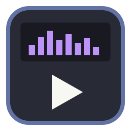

<p align="center">
  
</p>

<h1 align="center">AmpCraft</h1>

<p align="center">
  <b>A classic skinnable music player; open source, clean room, written in Rust.</b>
</p>

<p align="center">
  Play your music in the small, dockable main window, equalizer and playlist you remember. Load
  classic <code>.wsz</code> skins, pick a built-in theme, or let it take on your desktop's own
  colors. Native on Linux, with Windows on the way.
</p>

<p align="center">
  
  
  
  
</p>

<p align="center">
  <a href="#what-works-today">What works</a> ·
  <a href="#getting-started">Getting started</a> ·
  <a href="#themes-and-skins">Themes</a> ·
  <a href="#menus-and-keys">Menus and keys</a> ·
  <a href="#roadmap">Roadmap</a> ·
  <a href="#license-and-credits">License</a>
</p>

> [!NOTE]
> AmpCraft follows the conventions of the [ArtCraft](https://github.com/storytold/artcraft)
> Crafting Apps (layout, `cargo xtask ci`, never-crash rules, asset policy, MIT OR Apache-2.0)
> so it can be proposed as one of them. It is an independent project, not an official Crafting
> App. It started as a fork of [OpenAMP](https://github.com/Yuki-init/OpenAMP).

## What works today

AmpCraft is in early development (see the [roadmap](ROADMAP.md)). Today it can:

- **Play**: MP3, FLAC, Ogg, Opus, M4A/AAC, WMA, WAV and more, with seeking, gapless playback,
  repeat, shuffle and a play queue.
- **Look the part**: main window, playlist and equalizer that dock and snap together, shade
  mode, double size, shaped windows, and the spectrum and oscilloscope visualizer.
- **Theme**: classic `.wsz` skins, six built-in themes, and a **System** theme that follows
  your desktop's colors (the default).
- **Equalize**: 10 bands and a preamp, 18 built-in presets, your own presets, auto-load presets
  per track, and `.eqf` import and export.
- **Organize**: a media library with Artist and Album filters, search, Most Played, Recently
  Added and Never Played; `.m3u`, `.m3u8` and `.pls` playlists.
- **Fit in**: media keys and the desktop's now-playing controls (MPRIS on Linux, the media
  flyout on Windows), settings that save themselves.

## Getting started

Everything builds and runs inside rootless Podman; nothing needs installing on the host except
Podman.

```sh
git clone https://github.com/Yuki-init/AmpCraft
cd AmpCraft
scripts/build-image.sh            # once, or after changing the Containerfile or toolchain
scripts/fetch.sh                  # download crates (the only networked step)
scripts/dev.sh cargo build
scripts/check.sh                  # the quality gate: cargo xtask ci, Windows and macOS lint, cargo deny
scripts/host-run.sh ampcraft      # build in the container, run on the host with real audio
```

If ALSA's default device is unusable (common when PipeWire holds the card and `pipewire-alsa`
is not installed), the player falls back to the `pipewire` or `pulse` ALSA device. Pass
`--device NAME` to choose one. Set `AMPCRAFT_LOG=debug` for engine logs.

## Themes and skins

With no skin chosen, AmpCraft uses the **System** theme, painted from your desktop's colors:

- **KDE Plasma**: the full color scheme in use (window, list, button and selection colors).
- **Other Linux desktops**: light or dark and the accent color, from the XDG desktop portal.
- **Windows**: light or dark and the accent color from the system settings.

It follows changes while the player is running, and keeps the display text readable whatever
the colors. Pick it again from **Options ▸ Skins ▸ System colors** or the Skins page of the
preferences.

Six built-in themes are drawn in code from popular color schemes: `dracula`, `nord`,
`gruvbox`, `solarized`, `catppuccin` and `tokyonight`. Pick one with `--skin nord` (it is
remembered), or press Alt+S to cycle through System and the built-in themes. Classic `.wsz`
skins work with `--skin PATH` or **Load skin...** in the preferences.

`cargo run -p ampcraft --example theme_gallery -- OUT_DIR 2` renders every theme for a look.

## Menus and keys

The buttons on the left of the main window: **O** opens the preferences (also Ctrl+P), **A**
keeps the player above other windows, **I** shows the current track's file info, **D** toggles
double size and **V** opens the visualizer menu. Right-click the main window for the main menu
(or the visualizer for its menu).

The preferences window has four pages: General (always on top, size, time display), Playback
(repeat, shuffle, visualizer, output device), Skins (System colors, built-in themes, loading a
`.wsz`) and Media Library (folders, rescan). Changes apply at once and are saved, except the
output device, which is used from the next start.

In the playlist, drag selected tracks to move them, right-click tracks for Play, Queue, Remove,
Crop, File info, Select and Sort, and press Q to queue the selected tracks to play next (they
show [1], [2], ... and play before the normal order).

The equalizer's PRESETS button loads one of 18 built-in presets, saves and deletes your own
(kept in `eq-presets.toml` in the config folder), saves an auto-load preset for the current
track (applied whenever that file plays while AUTO is on), and imports or exports `.eqf` files.
Shaded, the equalizer shows volume and balance sliders.

The playlist's bottom buttons open their classic menus: **ADD** URL, folder or files; **REM**
all, crop, selected, or misc (missing files, duplicates); **SEL** invert, none, all; **MISC**
sort, file info, options; **LIST** new, save (`.m3u8`) and load (`.m3u`, `.m3u8`, `.pls`).

The media library (Alt+L) has a Local Media tree (Audio, Most Played, Recently Added, Recently
Played, Never Played), a search bar, Artist and Album filter panes (double-click one to play it)
and a sortable track list. The Library button adds folders and rescans; `--rescan` rescans at
start. Play counts are kept in the library file (`library.json`) in the data folder, never on the music
drive.

| Key | Does |
| --- | --- |
| Z X C V B | Previous, play, pause, stop, next |
| Left / Right | Back / forward 5 seconds |
| Up / Down | Volume |
| L | Play files |
| R / S | Repeat / shuffle |
| Ctrl+A | Always on top |
| Ctrl+D | Double size |
| Ctrl+T | Time elapsed / remaining |
| Alt+E / Alt+G / Alt+L | Playlist / equalizer / media library |
| Alt+S | Next theme (System, then the built-in themes) |
| Alt+3 | File info |
| Q (playlist) | Queue or unqueue the selected tracks |
| Ctrl+P | Preferences |

## Packages

**Arch Linux**: `scripts/build-arch-package.sh` builds a release package in an Arch container,
linked against Arch's own FFmpeg, into `dist/`. Install it with
`sudo pacman -U dist/ampcraft-*.pkg.tar.zst`. It installs `ampcraft` to `/usr/bin`, a desktop
entry and an icon. Config lives in `~/.config/ampcraft`, the library (`library.json`) in
`~/.local/share/ampcraft`. `packaging/arch/PKGBUILD` also works with plain `makepkg -si`.

**Windows (in progress)**: builds are cross-compiled in the dev container with MinGW and tested
under Wine. The player uses its own Win32 window backend, the system's file dialogs and the
media flyout (media keys). It has had a few test runs on real Windows so far.

```sh
scripts/fetch-ffmpeg-windows.sh   # pinned LGPL FFmpeg build for Windows, into .cache/ (networked)
scripts/build-windows.sh          # ampcraft.exe plus FFmpeg DLLs in dist/windows/
scripts/package-windows.sh        # portable zip in dist/, with a test kit for a real Windows machine
```

## Music library tests

Set `AMPCRAFT_MUSIC_HOST_DIR` to a music folder (in the environment, or in `scripts/local.env`,
which is not committed) and the scripts mount it read-only at `/music`; opt-in tests then decode
a sample of it, printing aggregate results only. Without it, those tests are skipped.
`AMPCRAFT_TEST_MUSIC_SAMPLE` sets the sample size (default 60).

## Roadmap

See [ROADMAP.md](ROADMAP.md) for what is next, and [docs/gaps.md](docs/gaps.md) for the work
still needed to meet the Crafting Apps standards (an egui UI, no `unsafe`, a command layer).

## Contributing

Read [AGENTS.md](AGENTS.md) first: its rules (asset policy, clean room, never crash) bind every
contributor, human or AI. Run `scripts/check.sh` before you open a pull request.

## License and credits

Licensed under either of the [MIT License](LICENSE-MIT) or the
[Apache License, Version 2.0](LICENSE-APACHE), at your option. FFmpeg is linked dynamically
(LGPL builds). Third-party material and credits are in [ATTRIBUTION.md](ATTRIBUTION.md) and
[NOTICE](NOTICE).

AmpCraft is not affiliated with Winamp or Nullsoft; the name is mentioned only to describe skin
format compatibility.
